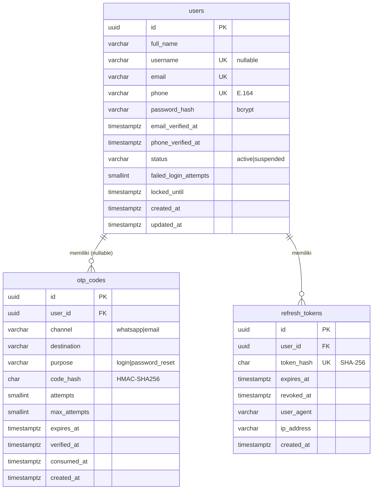

# Dokumen Database

DBMS: **PostgreSQL 13+** · Migrasi: [`migrations/001_init.sql`](../migrations/001_init.sql) · DBML (dbdiagram.io): [`erd.dbml`](erd.dbml)

## 1. ERD

## 2. Struktur Tabel

### `users`
| Kolom | Tipe | Null | Keterangan |
|---|---|---|---|
| id | UUID | NO | PK, `gen_random_uuid()` |
| full_name | VARCHAR(100) | NO | "Nama Lengkap" di form register |
| username | VARCHAR(30) | YES | Opsional; login layar 1 menerima "Email atau Username" |
| email | VARCHAR(254) | NO | Disimpan lowercase |
| phone | VARCHAR(16) | NO | Format E.164 (`+62812…`), dinormalisasi di API |
| password_hash | VARCHAR(100) | NO | bcrypt (cost 12) |
| email_verified_at / phone_verified_at | TIMESTAMPTZ | YES | `phone_verified_at` terisi saat berhasil login via OTP WhatsApp |
| status | VARCHAR(16) | NO | `active` (default) / `suspended` |
| failed_login_attempts | SMALLINT | NO | Untuk "Sisa 2x" & lockout |
| locked_until | TIMESTAMPTZ | YES | Akun terkunci sampai waktu ini |
| created_at / updated_at | TIMESTAMPTZ | NO | default `now()` |

### `otp_codes`
Satu baris per OTP yang dikirim (login WhatsApp & lupa password, via email/WhatsApp).
| Kolom | Tipe | Null | Keterangan |
|---|---|---|---|
| id | UUID | NO | PK |
| user_id | UUID | YES | FK → users (CASCADE) |
| channel | VARCHAR(16) | NO | `whatsapp` / `email` |
| destination | VARCHAR(254) | NO | Email atau nomor E.164 tujuan |
| purpose | VARCHAR(32) | NO | `login` / `password_reset` |
| code_hash | CHAR(64) | NO | HMAC-SHA256(secret, purpose\|destination\|kode). **Kode tidak disimpan plaintext** |
| attempts / max_attempts | SMALLINT | NO | Percobaan salah / batas (default 5) |
| expires_at | TIMESTAMPTZ | NO | created_at + 5 menit |
| verified_at | TIMESTAMPTZ | YES | Terisi saat kode benar |
| consumed_at | TIMESTAMPTZ | YES | Terisi saat dipakai / digantikan OTP baru → **sekali pakai** |
| created_at | TIMESTAMPTZ | NO | Dasar cooldown kirim-ulang (60 dtk) & batas per jam |

### `refresh_tokens`
| Kolom | Tipe | Null | Keterangan |
|---|---|---|---|
| id | UUID | NO | PK |
| user_id | UUID | NO | FK → users (CASCADE) |
| token_hash | CHAR(64) | NO | SHA-256 dari token mentah (token mentah tidak disimpan) |
| expires_at | TIMESTAMPTZ | NO | 24 jam, atau 30 hari jika "Ingat saya" |
| revoked_at | TIMESTAMPTZ | YES | Terisi saat rotasi / logout / reset password |
| user_agent, ip_address | VARCHAR | NO | Metadata sesi |
| created_at | TIMESTAMPTZ | NO | |

## 3. Relasi
| Relasi | Kardinalitas | Aturan hapus |
|---|---|---|
| users → otp_codes | 1 : N (opsional) | `ON DELETE CASCADE` |
| users → refresh_tokens | 1 : N | `ON DELETE CASCADE` |

## 4. Constraint
| Tabel | Constraint | Tujuan |
|---|---|---|
| users | `uq_users_email`, `uq_users_phone`, `uq_users_username` (UNIQUE) | Mencegah duplikat → API membalas 409 (pesan "Email/Nomor sudah terdaftar" di UI) |
| users | `ck_users_email_lower`, `ck_users_username_lower` | Unik case-insensitive tanpa extension |
| users | `ck_users_phone_fmt` (`^\+628[0-9]{8,11}$`) | Hanya nomor seluler Indonesia format E.164 |
| users | `ck_users_status`, `ck_users_failed_attempts` | Integritas nilai |
| otp_codes | `ck_otp_channel`, `ck_otp_purpose`, `ck_otp_expiry` | Integritas nilai |
| refresh_tokens | `uq_refresh_tokens_hash` (UNIQUE) | Lookup cepat & anti duplikat |

## 5. Index
| Index | Kolom | Dipakai untuk |
|---|---|---|
| (implisit) PK & UNIQUE di atas | email, phone, username, token_hash | Login, cek duplikat, refresh token |
| `idx_otp_lookup` | `otp_codes (destination, purpose, created_at DESC)` | Ambil OTP terbaru, cooldown, hitung per jam |
| `idx_otp_user` | `otp_codes (user_id)` | Join/cleanup per user |
| `idx_otp_cleanup` | `otp_codes (expires_at) WHERE consumed_at IS NULL` (partial) | Job pembersihan OTP kedaluwarsa |
| `idx_refresh_user_live` | `refresh_tokens (user_id) WHERE revoked_at IS NULL` (partial) | Cabut semua sesi user |
| `idx_refresh_expires` | `refresh_tokens (expires_at)` | Job pembersihan token kedaluwarsa |

## 6. Catatan desain
- **Kode OTP & refresh token tidak pernah disimpan plaintext** (HMAC / SHA-256).
- Meminta OTP baru otomatis meng-*consume* OTP aktif sebelumnya untuk tujuan & purpose yang sama.
- Pembersihan berkala (cron): `DELETE FROM otp_codes WHERE expires_at < now() - interval '1 day'` dan `DELETE FROM refresh_tokens WHERE expires_at < now() - interval '7 days'`.

### Database
![Daftar Tabel] (screenshot/db-tabel.png)
